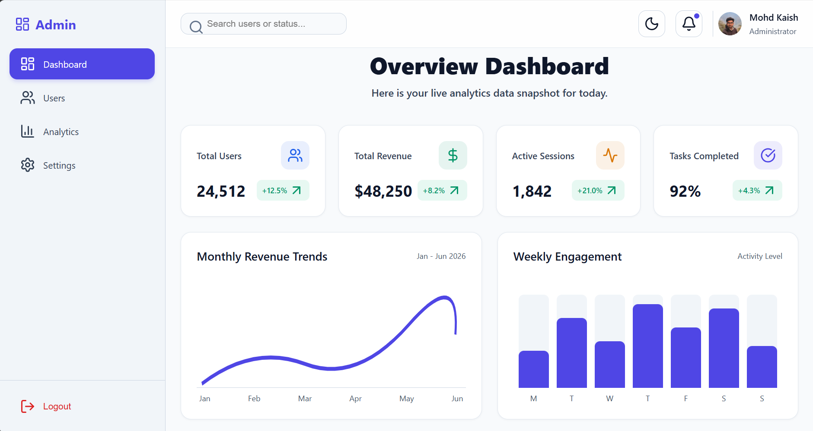
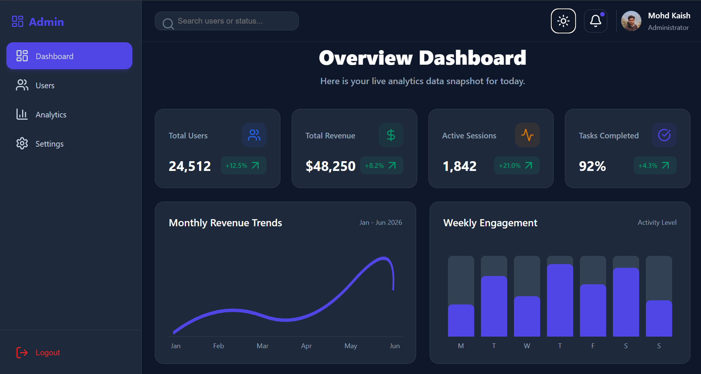
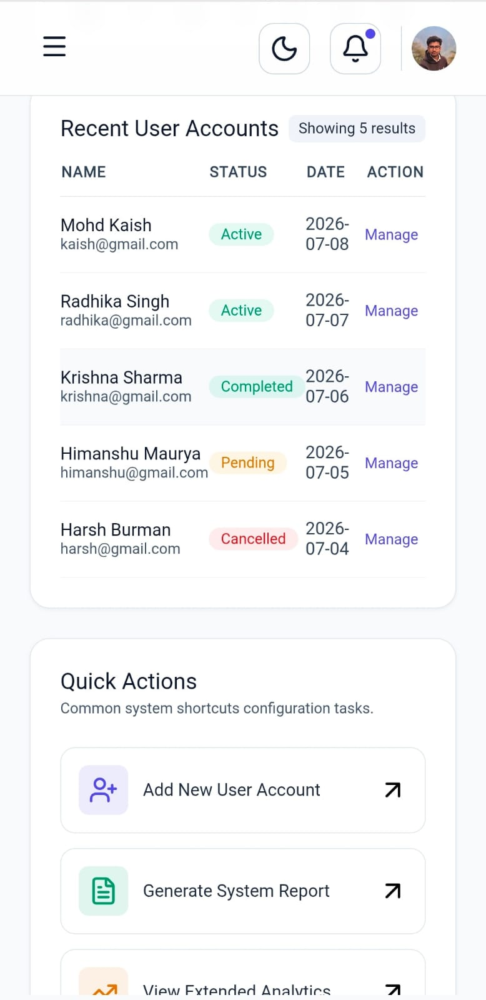

# 📊 Admin Dashboard

A modern and responsive **Admin Dashboard** built with **React 18** and **Vite**. The project features a clean dashboard interface with analytics cards, charts, data tables, quick actions, responsive navigation, live search, and a dark/light theme. It is designed using reusable React components and plain CSS for a lightweight and maintainable codebase.

---

[](https://admin-dashboard-pi-sooty-96.vercel.app)

---

## 📸 Dashboard Preview

### ☀️ Desktop View



### 🌙 Dark Mode



### 📱 Mobile View

<p align="center">
  
</p>

---

# ✨ Features

- 📊 Dashboard Overview
- 📈 Analytics & Statistics Cards
- 📉 Charts Section
- 📋 Responsive Data Table
- ⚡ Quick Actions Panel
- 📂 Sidebar Navigation
- 🔍 Live Search Functionality
- 🌙 Dark / Light Theme Toggle
- 📱 Fully Responsive Design
- ♻️ Reusable React Components

---

## 🛠️ Tech Stack

<p align="left">
  
  
  
  
  
  
  
</p>

> **Note:** Tailwind CSS and all related plugins have been completely removed from this project.

---

# Project Structure 

```
admin-dashboard/
│── public/
│── src/
│   ├── assets/
│   ├── components/
│   │   ├── *.jsx
│   │   └── *.css
│   ├── App.jsx
│   ├── main.jsx
│   ├── App.css
│   └── index.css
│── package.json
│── index.html
│── vite.config.js
└── README.md

```
---

# 🧩 Components

### 📂 Sidebar

- Dashboard navigation
- Responsive menu
- Mobile sidebar support

### 📌 Header

- Search bar
- Notification icon
- Theme toggle
- User actions

### 📊 Stats Cards

- Displays important dashboard metrics
- Responsive card layout

### 📈 Charts Section

- Analytics visualization
- Responsive chart container

### 📋 Data Table

- Displays tabular information
- Responsive layout

### ⚡ Quick Actions

- Frequently used dashboard actions
- Easy accessibility

---

# 💡 Key Implementations

### 🌙 Theme Management

Dark and Light mode is managed using **React useState**, allowing the UI to switch instantly without reloading the page.

### 🔍 Live Search

Implemented using JavaScript's `.filter()` and `.map()` methods for real-time client-side searching.

### 📱 Responsive Design

- CSS Grid
- Flexbox
- Mobile-first layout

### ⚛️ React Concepts Used

- Functional Components
- useState
- useEffect
- Component-based Architecture
- Props

---

# ⚙️ Installation

Clone the repository

```bash
git clone https://github.com/kaish10-hub/admin-dashboard.git
```

Go to the project directory

```bash
cd admin-dashboard
```

Install dependencies

```bash
npm install
```

Run the development server

```bash
npm run dev
```

---

# 🚀 Future Improvements

- API Integration
- Authentication
- Real-Time Analytics
- Export Reports
- User Management
- Notifications

---

# 👨‍💻 Author

**Mohd Kaish**

- GitHub: https://github.com/kaish10-hub

---

# ⭐ Show Your Support

If you liked this project, don't forget to ⭐ **Star** this repository.
